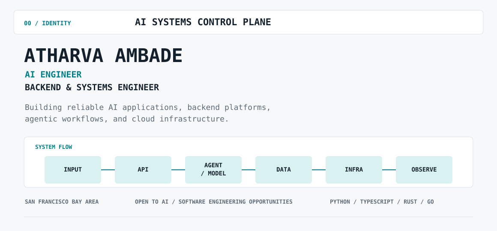
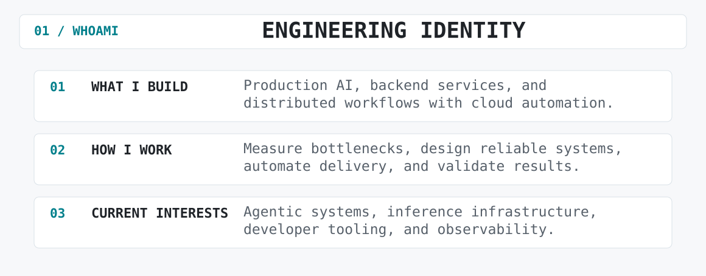
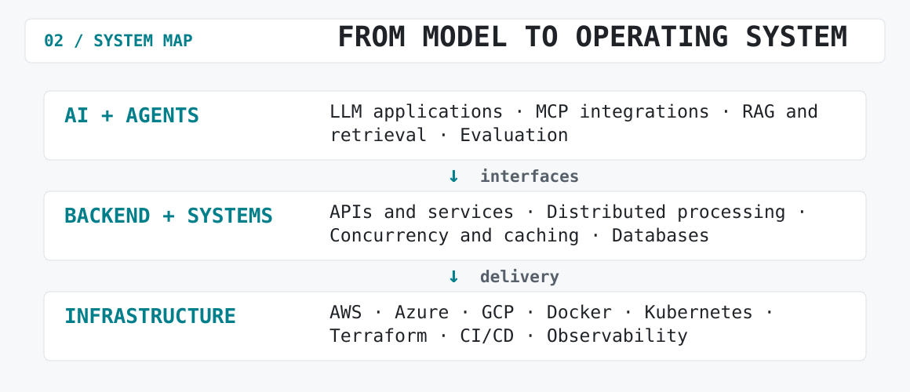
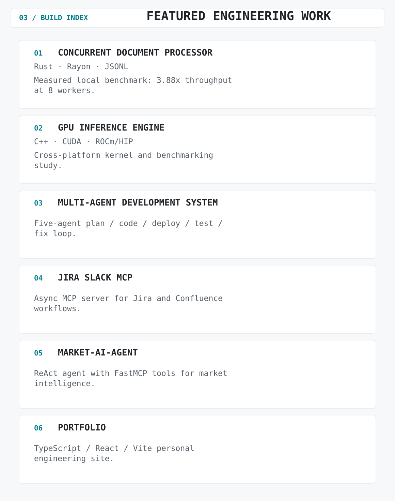
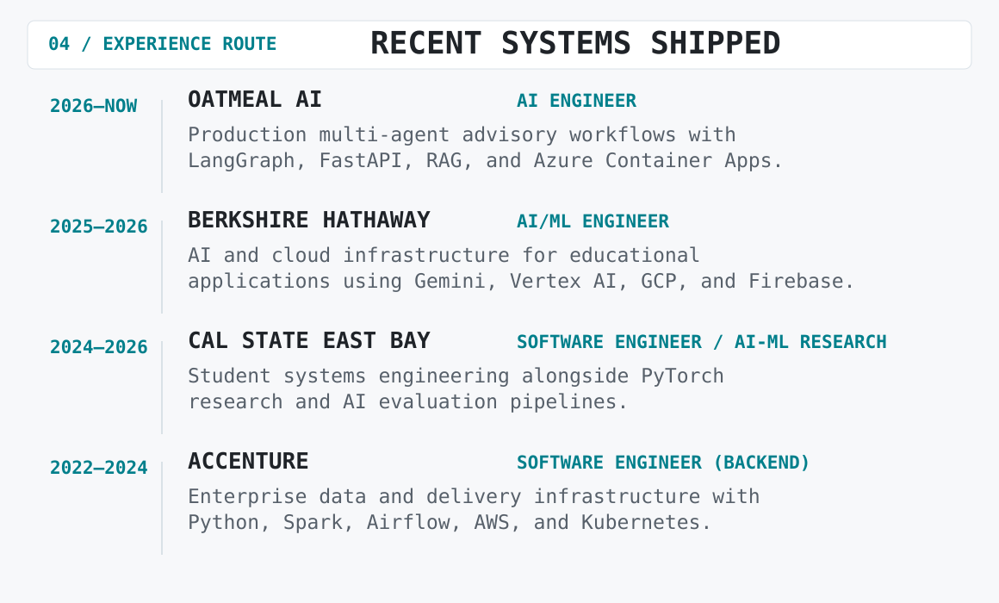
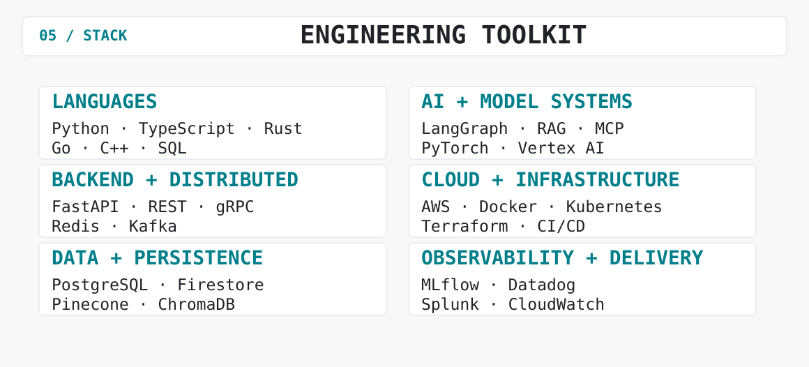
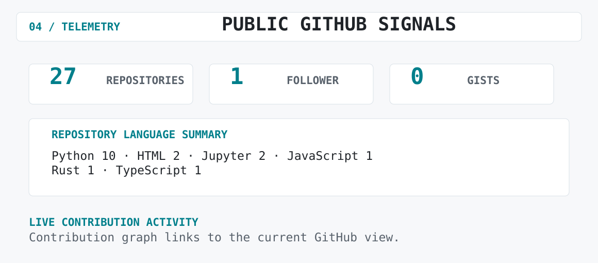
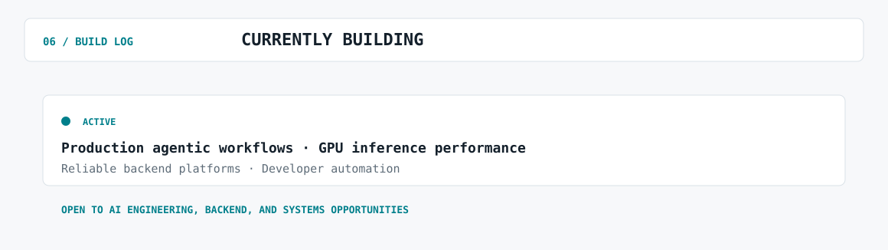

<picture>
  <source media="(prefers-color-scheme: dark)" srcset="./assets/dark/header.svg">
  <source media="(prefers-color-scheme: light)" srcset="./assets/light/header.svg">
  
</picture>

<a href="https://ambadeatharva.github.io/">Portfolio</a>
&nbsp;&nbsp;·&nbsp;&nbsp;
<a href="https://ambadeatharva.github.io/Resume_Master.pdf">Résumé</a>
&nbsp;&nbsp;·&nbsp;&nbsp;
<a href="https://www.linkedin.com/in/ambadeatharva">LinkedIn</a>
&nbsp;&nbsp;·&nbsp;&nbsp;
<a href="mailto:atharva.suneel.ambade@gmail.com">Email</a>
&nbsp;&nbsp;·&nbsp;&nbsp;
<a href="https://github.com/AmbadeAtharva?tab=repositories">Repositories</a>

<picture>
  <source media="(prefers-color-scheme: dark)" srcset="./assets/dark/whoami.svg">
  <source media="(prefers-color-scheme: light)" srcset="./assets/light/whoami.svg">
  
</picture>

<picture>
  <source media="(prefers-color-scheme: dark)" srcset="./assets/dark/system-map.svg">
  <source media="(prefers-color-scheme: light)" srcset="./assets/light/system-map.svg">
  
</picture>

<picture>
  <source media="(prefers-color-scheme: dark)" srcset="./assets/dark/projects.svg">
  <source media="(prefers-color-scheme: light)" srcset="./assets/light/projects.svg">
  
</picture>

<a href="https://github.com/AmbadeAtharva/concurrent-document-processor">concurrent-document-processor</a>
&nbsp;·&nbsp;
<a href="https://github.com/AmbadeAtharva/GPU-Inference-Engine">GPU-Inference-Engine</a>
&nbsp;·&nbsp;
<a href="https://github.com/AmbadeAtharva/Multi-Agent-Development-System">Multi-Agent-Development-System</a>
&nbsp;·&nbsp;
<a href="https://github.com/AmbadeAtharva/jira-slack-mcp">jira-slack-mcp</a>
&nbsp;·&nbsp;
<a href="https://github.com/AmbadeAtharva/Market-AI-Agent">Market-AI-Agent</a>
&nbsp;·&nbsp;
<a href="https://github.com/AmbadeAtharva/AmbadeAtharva.github.io">portfolio source</a>

<picture>
  <source media="(prefers-color-scheme: dark)" srcset="./assets/dark/experience.svg">
  <source media="(prefers-color-scheme: light)" srcset="./assets/light/experience.svg">
  
</picture>

<picture>
  <source media="(prefers-color-scheme: dark)" srcset="./assets/dark/stack.svg">
  <source media="(prefers-color-scheme: light)" srcset="./assets/light/stack.svg">
  
</picture>

<picture>
  <source media="(prefers-color-scheme: dark)" srcset="./assets/dark/telemetry.svg">
  <source media="(prefers-color-scheme: light)" srcset="./assets/light/telemetry.svg">
  
</picture>

<a href="https://github.com/AmbadeAtharva?tab=overview">
  <picture>
    <source media="(prefers-color-scheme: dark)" srcset="https://ghchart.rshah.org/62d9d4/AmbadeAtharva">
    <source media="(prefers-color-scheme: light)" srcset="https://ghchart.rshah.org/007f8b/AmbadeAtharva">
    
  </picture>
</a>

<picture>
  <source media="(prefers-color-scheme: dark)" srcset="./assets/dark/current-focus.svg">
  <source media="(prefers-color-scheme: light)" srcset="./assets/light/current-focus.svg">
  
</picture>

<a href="https://ambadeatharva.github.io/">Portfolio</a>
&nbsp;&nbsp;·&nbsp;&nbsp;
<a href="https://ambadeatharva.github.io/Resume_Master.pdf">Résumé</a>
&nbsp;&nbsp;·&nbsp;&nbsp;
<a href="https://www.linkedin.com/in/ambadeatharva">LinkedIn</a>
&nbsp;&nbsp;·&nbsp;&nbsp;
<a href="mailto:atharva.suneel.ambade@gmail.com">atharva.suneel.ambade@gmail.com</a>

